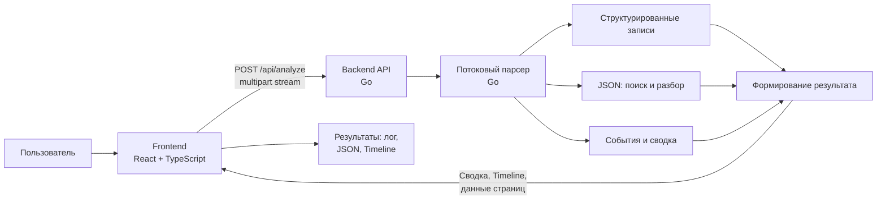

# Архитектура приложения TerraLyze

Архитектура перенесена из приложенной схемы и MVP-описания; это проектное решение, не текущая реализация.

## Поток данных

1. Браузер проверяет расширение и размер файла.
2. Frontend отправляет файл на `POST /api/analyze` с прогрессом загрузки.
3. Go backend читает входящий поток построчно и передаёт его парсеру.
4. Парсер выделяет поля, находит JSON-фрагменты, собирает события и счётчики.
5. Backend возвращает сводку и данные диаграммы; строки лога предполагается выдавать страницами.
6. Frontend показывает фильтры, дерево JSON, подсветку и Timeline.

## Компоненты

- **Frontend:** загрузка, валидация, прогресс, фильтры, просмотр строк, JSON-дерево и диаграмма.
- **Backend API:** приём файла и ответ со структурированными результатами.
- **Парсер:** потоковое чтение и извлечение данных.
- **Визуализация:** Apache ECharts (предложенный стек).
- **Деплой:** Docker и облачный хостинг (предложенный вариант).

## Важные свойства

- Исходный файл не должен сохраняться дольше обработки; очистка временных данных должна быть проверяема.
- Передача сотен тысяч строк целиком в браузер может тормозить; в требованиях указана выдача порциями.
- Формат Terraform-лога и правила извлечения времени/операций нужно зафиксировать на реальных примерах.
